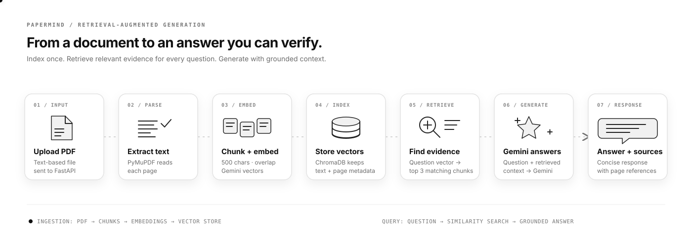

<div align="center">

# PaperMind

### Ask your documents. Get answers grounded in their pages.

PaperMind is a full-stack **Retrieval-Augmented Generation (RAG)** app for uploading text-based PDFs and asking questions in plain language. It retrieves relevant passages from your documents, then uses Gemini to write a concise answer with filename and page references.

<p>
  
  
  
  
</p>

<p>
  <a href="https://document-q-a-bot-rag.onrender.com"><strong>Live API</strong></a>
  &nbsp;·&nbsp;
  <a href="#quick-start"><strong>Run locally</strong></a>
  &nbsp;·&nbsp;
  <a href="#api-reference"><strong>API reference</strong></a>
</p>

</div>

---

## RAG, from PDF to answer

The animated diagram follows both paths: document ingestion builds the searchable knowledge base, and each question retrieves evidence before generation.

<div align="center">
  
</div>

### What happens under the hood

1. **Upload:** FastAPI validates the PDF and extracts page text with PyMuPDF.
2. **Chunk:** Each page is split into 500-character segments with a 50-character overlap, preserving page numbers.
3. **Embed and index:** Gemini Embeddings (`gemini-embedding-001`) turns each segment into a 768-dimensional vector. ChromaDB stores the vector, text, filename, and page metadata.
4. **Retrieve:** Gemini embeds the question in retrieval-query mode. ChromaDB returns the three nearest passages by default.
5. **Generate:** The retrieved passages and question are sent to Gemini (`gemini-3.8-flash`) with instructions to stay grounded in the evidence.
6. **Respond:** The answer is returned to the chat with source filename and page references when available.

## Features

- Upload and index text-based PDF documents
- Ask natural-language questions about the indexed content
- Semantic retrieval with hosted Gemini embeddings
- Answers grounded in retrieved passages, with filename and page references
- Bring your own Gemini API key; it is submitted per request and is not saved by the app
- Responsive, monochrome chat interface with suggested questions
- Persistent local ChromaDB collection between backend restarts

## Tech stack

| Layer | Technology |
| --- | --- |
| Frontend | React 19, Vite 8 |
| API | FastAPI, Uvicorn |
| PDF text extraction | PyMuPDF |
| Chunk embeddings | Gemini Embeddings API, `gemini-embedding-001` |
| Vector database | ChromaDB persistent client |
| Answer generation | Google Gemini API (`gemini-3.8-flash`) |

## Quick start

### Prerequisites

- Python 3.11 or later
- Node.js and npm
- A Gemini API key for asking questions ([Google AI Studio](https://aistudio.google.com/app/apikey))

### 1. Start the backend

From the repository root:

```bash
cd backend
python -m venv .venv
```

Activate the environment:

```bash
# macOS / Linux
source .venv/bin/activate

# Windows PowerShell
.venv\Scripts\Activate.ps1
```

Install the Python packages and run the API:

```bash
pip install -r requirements.txt
uvicorn main:app --reload --host 127.0.0.1 --port 8000
```

The API is available at `http://127.0.0.1:8000`; interactive API docs are at `http://127.0.0.1:8000/docs`.

> PDF indexing and questions each call Gemini Embeddings. The API key you enter in the UI is sent with both requests and is not saved by the app.

### 2. Configure and start the frontend

In a second terminal, from the repository root:

```bash
cd frontend
npm install
```

Create `frontend/.env` for local development:

```ini
VITE_API_URL=http://127.0.0.1:8000
```

Start Vite:

```bash
npm run dev
```

Open the local URL printed by Vite (usually `http://localhost:5173`). In the app, enter your Gemini API key, upload a PDF, and ask a question. The key is required during upload so the backend can embed document chunks, and again when asking so it can embed the query and generate the answer.

### Environment variables

| Variable | Used by | Purpose |
| --- | --- | --- |
| `VITE_API_URL` | Frontend | Public base URL for the FastAPI service, such as `https://document-q-a-bot-rag.onrender.com`. The app falls back to the project’s Render URL when unset. |
| `FRONTEND_ORIGIN` | Backend (optional) | Exact custom frontend origin to allow through CORS; Vercel `*.vercel.app` origins are allowed automatically. |

Vite injects `VITE_` variables into browser code at build time. **Only put the public backend URL here. Never put a Gemini API key or other secret in a `VITE_` variable.** Set the production value in your frontend host’s environment-variable settings and rebuild/redeploy.

The local `frontend/.env` is ignored by Git. For a hosted deployment, configure the variable in the hosting provider (for example, Vercel) instead of relying on a local file.

## API reference

### `GET /`

Returns a health message and the number of records in the ChromaDB collection.

### `POST /upload-pdf`

Upload a PDF using `multipart/form-data` with `file` and `api_key` fields.

```bash
curl -X POST "http://127.0.0.1:8000/upload-pdf" \
  -F "file=@./document.pdf" \
  -F "api_key=YOUR_GEMINI_API_KEY"
```

The response includes the filename, extracted page count, created and stored chunk counts, and total collection records.

### `POST /ask`

Send a JSON request containing the question, Gemini API key, and optional retrieval count (`top_k`, from 1 to 10; default 3).

```bash
curl -X POST "http://127.0.0.1:8000/ask" \
  -H "Content-Type: application/json" \
  -d '{
    "question": "What are the key findings?",
    "api_key": "YOUR_GEMINI_API_KEY",
    "top_k": 3
  }'
```

The response contains the original question and generated answer. The Gemini key is required per request; do not commit it or put it in frontend environment variables.

## Deployment notes

The project is structured as a Vite frontend and a separate FastAPI backend. A typical setup is **Vercel for the frontend + Render for the backend**.

1. Configure the Render web service with root directory `backend`, build command `pip install -r requirements.txt`, and start command `uvicorn main:app --host 0.0.0.0 --port $PORT`.
2. Set `VITE_API_URL` in the frontend host to the deployed backend URL, with no trailing slash, then rebuild/redeploy.
3. The backend allows Vercel `*.vercel.app` deployment origins. If you use a custom frontend domain, set `FRONTEND_ORIGIN` on the backend host to that exact origin (for example, `https://docs.example.com`).
4. The entered Gemini API key is required for PDF upload embeddings and question answering. It is submitted per request and is not written to disk.
5. Configure persistent storage for `chroma_db` on the backend host. The current ChromaDB path is local (`./chroma_db`); data on an ephemeral deployment filesystem can be lost when the service is replaced.
6. This deployment uses Gemini Embeddings instead of a local PyTorch model to keep backend memory use lower. Embeddings from the previous `all-MiniLM-L6-v2` collection are incompatible; upload your PDFs again after redeploying.

## Project structure

```text
.
├── backend/
│   ├── main.py          # FastAPI endpoints and CORS configuration
│   ├── ingestion.py     # PDF page text extraction
│   ├── chunking.py      # Page-aware overlapping chunks
│   ├── embeddings.py    # Gemini hosted document and query embeddings
│   ├── vector_store.py  # Persistent ChromaDB storage
│   ├── retrieval.py     # Similarity search
│   ├── qa.py            # Gemini prompt and answer generation
│   └── requirements.txt
├── frontend/
│   ├── src/App.jsx      # Upload, API key, and chat experience
│   └── package.json
└── docs/
    └── rag-workflow.svg # Animated RAG workflow diagram
```

## Current limitations

- Scanned/image-only PDFs are not OCR processed; the current pipeline needs extractable PDF text.
- The app sends document text to Gemini Embeddings while indexing, then sends retrieved passages and the question to Gemini to generate an answer. Avoid uploading sensitive documents unless that processing is appropriate for your use case.
- The vector collection is shared by the backend instance; this project does not currently provide user accounts or per-user document isolation.
- Document indexing and vectors depend on the backend’s persistent disk. A fresh or ephemeral instance may need documents uploaded again.
- Embedding generation uses the Gemini API, so indexing and retrieval require a valid Gemini API key and network access.
- Custom frontend domains must be configured with `FRONTEND_ORIGIN` before browser requests will succeed.

## License

No license file is currently included. Add a `LICENSE` file before redistributing this project under a specific open-source license.

<div align="center">

**PaperMind · Find the evidence. Ask better questions.**

</div>
